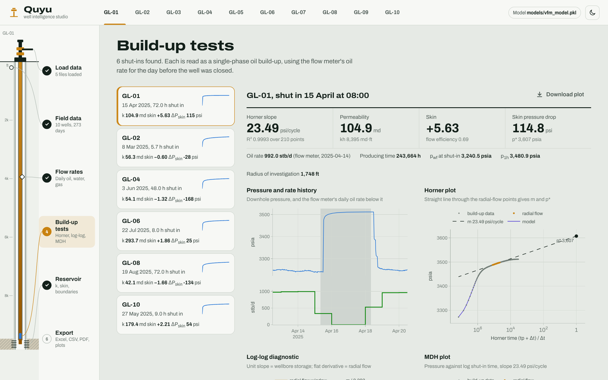
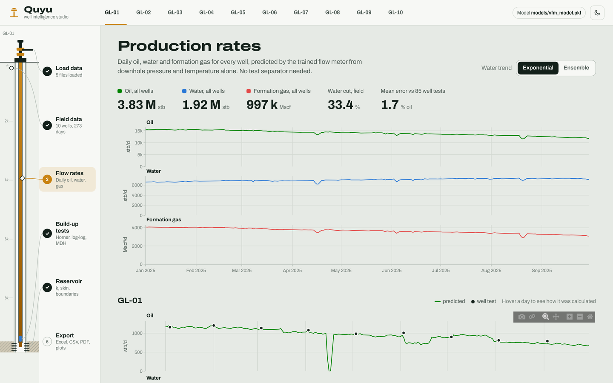
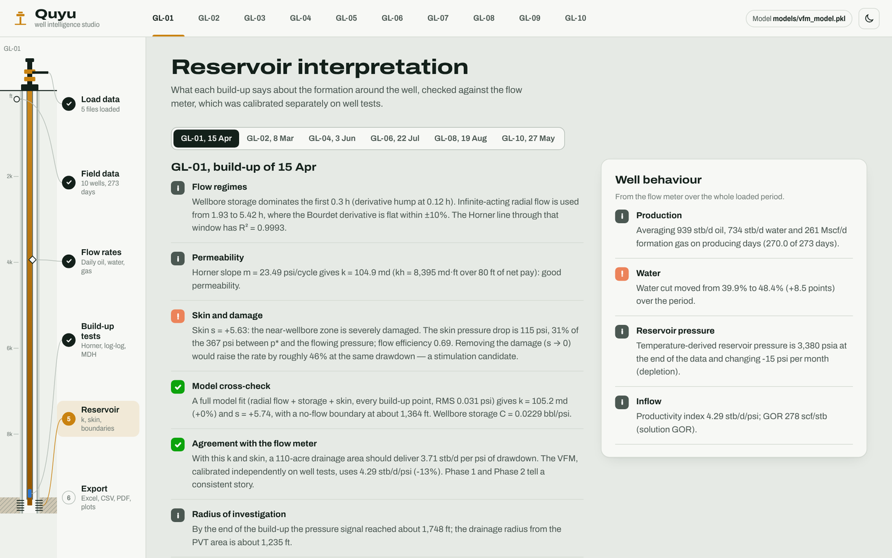

# Quyu: well intelligence studio

*Quyu* is Azerbaijani for *well*. Quyu takes raw field data from gas-lifted oil wells and carries it to a final reservoir interpretation, in one application:

**raw sensors → cleaned data → daily oil, water and gas rates (virtual flow meter) → automated build-up analysis → reservoir interpretation → Excel, CSV, PDF and plots**

Built for the SOCAR Hackathon 2026 *Intelligent Well Performance Analysis* challenge.



---

## Quick start in VS Code

1. **Open the folder** in VS Code: *File → Open Folder… → quyu-well-intelligence*.
2. **Create an environment** in the terminal (*Terminal → New Terminal*):
   ```bash
   python -m venv .venv
   # Windows:       .venv\Scripts\activate
   # macOS / Linux: source .venv/bin/activate
   pip install -r requirements.txt
   ```
   Choose `.venv` when VS Code asks for an interpreter.
3. **Optional: put the organiser's CSVs in `data/`.** The app gets a *Use the files in the data folder* button for one-click loading. Otherwise drag the files into the app.
4. **Run it:** press **F5** and pick *Quyu: run the app*, or type:
   ```bash
   python run.py
   ```
   The browser opens at **http://127.0.0.1:8765**. If port 8765 is busy, use `python run.py --port 8800`.

The trained model, `models/vfm_model.pkl`, loads automatically.

## Demo walkthrough for the evaluation

| Step | What to show |
|---|---|
| **1 Load data** | Drag the test files onto the drop zone. Each file is recognised from its columns, so file names do not matter. Only the sensor file is required: PVT, completion data and the trained parameters travel inside the model. Missing shut-ins are found from the gas-lift record. Press **Run analysis** and the tubing in the well drawing fills as each stage completes (about 20 s for 3 months of data, about 1 min for 9). |
| **2 Field data** | Six aligned sensor panels with min-max bands, so spikes and gaps stay visible. Zoom down to individual minutes, use *Show raw readings* to see what cleaning removed, and use *Jump to* for any shut-in. The data-quality table lists sentinels, spikes and missing minutes per well. |
| **3 Flow rates** | Field totals and daily oil, water and gas per well, with well tests overlaid. **Hover any day** and *How the rate is calculated* walks through the arithmetic with that well's numbers (temperature → heating → reservoir pressure → drawdown → × productivity index → rate). Also a predicted-vs-measured plot against every well test. |
| **4 Build-up tests** | One card per shut-in, and the four required results: **Horner plot slope, permeability, skin, ΔP skin**, taken from a full model regression (Laplace / Stehfest: radial flow, storage, skin, boundary; purple curves) fitted to every build-up point. Also the history, Horner, log-log (Bourdet derivative) and MDH plots. The Horner straight line is shown as the check: **drag the radial-flow window** and the straight-line values recompute next to the reported ones; *Back to automatic* restores it. |
| **5 Reservoir** | Plain-language interpretation per shut-in: flow regimes, permeability class, damage and the stimulation upside, boundary, radius of investigation. It also shows that **Phase 1 and Phase 2 agree**: the productivity implied by the build-up's k and skin matches the flow meter's, calibrated separately, within 15% for all 6 shut-ins. Plus reservoir pressure trends for all wells. |
| **6 Export** | Phase 1 Excel and CSV, Phase 2 Excel and CSV, all plots (PNG zip), a PDF report, the model `.pkl`, or everything as one zip. |

Shortcuts: **1-6** switch stages, **[ ]** previous and next well, **T** day / night theme.



## Deliverables in this repository

| Required | Where |
|---|---|
| Result files for Phase 1 and Phase 2 (CSV / Excel) | `results/Phase1_VFM_predictions.csv`, `.xlsx`, `results/Phase2_PTA_results.csv`, `.xlsx` |
| Trained model in `.pkl` format | `models/vfm_model.pkl` |
| Notebook with all cells run, showing the best results | `notebooks/Phase1_VFM.ipynb`, `notebooks/Phase2_PTA.ipynb` (plus `notebooks/Validation_walk_forward.ipynb`) |
| Folder with all PTA plots | `results/pta_plots/` |
| Application: upload data, visualise, predict with the trained model, well-test plots, reservoir properties, interpretation, export | `run.py`, `app/`, `wellintel/` |
| PDF report | `results/Well_performance_report.pdf` |

The result CSVs are our best-scoring submissions. `python tests/test_reproduce.py` checks that the app, using only `models/vfm_model.pkl`, regenerates them **byte for byte**. This was tested with pandas 2.2 and 3.0; `requirements.txt` keeps pandas below 3.1, which rounds a few daily rates differently (by at most 0.04 stb/d).

## How it works

### Phase 1: physics-informed virtual flow meter
Gas-lifted wells heat up at the gauge as fluid flows from the reservoir (Joule-Thomson effect): `T = T_res + η · (P_res − P_wf)`.
1. **Cleaning:** drop duplicates, set −999.25 sentinels to missing, remove spikes against a 7-minute rolling median, rebuild a 1-minute grid and interpolate short gaps. Shut-ins come from choke events, cross-checked against gas-lift rate = 0.
2. **Reservoir pressure from temperature:** `P_res = P_wf + (T − T_res) / η`, with η fitted per well on stable hours (no labels used), then smoothed robustly over ±10 days.
3. **Rates per minute, averaged per day:** oil = `J × drawdown` (one number per well; GL-06 also has an offset that corrects a ≈0.35 °F reservoir-temperature error). Water = `exp(a + b·t) × drawdown`. Formation gas = solution GOR × oil. All are zero while shut in.
4. Calibrated on 85 cleaned well tests (sign flips fixed; GL-06 gas converted from Sm³/d to Mscf/d). Model choices were made by leave-one-out.

| Mean error vs well tests | Oil | Water | Gas |
|---|---|---|---|
| In-sample | 1.7% | 3.0% | 5.6% |
| Leave-one-test-out | 1.9% | 4.0% | 5.5% |
| **Walk-forward: train before a cut-off, score later months (4 cut-offs)** | **2.1%** | **6.1%** | **5.9%** |

Oil and gas barely change on unseen months, so the model does not overfit. Water extrapolates a rising water-cut trend, so its error grows with the forecast horizon. An *Ensemble* water option (switch in the app) averages two trend shapes and was more accurate at all four cut-offs.

### Phase 2: automated build-up analysis
Single-phase oil, using the flow meter's oil rate on the last fully producing day before the shut-in. `tp = 24 · Np / q`, where Np = cumulative oil at 1-Jan-2025 plus the flow-meter cumulative.
**Reported values:** a radial-flow + wellbore-storage + skin model, with infinite, closed or constant-pressure boundary, solved in Laplace space with Stehfest inversion and fitted to every build-up point (40 log-spaced bins per cycle; boundary chosen by AIC). Fit error is 0.02-0.07 psi RMS, the sensor noise level. The reported Horner slope is the radial-flow slope `m = 162.6 q B μ / (k h)` and `ΔP_skin = 0.8686 m s`. This handles the three build-ups whose derivative never flattens within the shut-in (GL-02 5.6 h, GL-06 8 h, GL-04 still in storage transition at 48 h), where a straight line overstates m.
**Check:** the Bourdet derivative finds the radial-flow window (flat within ±10%, after the wellbore-storage hump) and a Horner straight line through it gives `k = 162.6 q B μ / (m h)`, `s = 1.1513 [(p1h − pwf)/m − log(k/(φ μ c_t r_w²)) + 3.2275]`. Both are in the Phase 2 workbook.



## Deploying

**For the evaluation demo, run it on your laptop** (Quick start above). It needs no internet and is the most reliable option.

**Shareable link, easiest: Hugging Face Spaces (free, 2 vCPU / 16 GB RAM).** The YAML block at the top of this README already configures it.
1. Sign in at huggingface.co → *New Space* → name it → SDK **Docker** (blank) → hardware **CPU basic (free)** → choose Public or Private → *Create Space*.
2. In the Space: *Files* → *Add file* → *Upload files*, drag in **everything inside this folder** (README.md, Dockerfile, app/, wellintel/, models/, run.py, requirements.txt, ...), not the `data/` CSVs → *Commit*.
3. Wait for the build (a few minutes; the *Logs* tab shows progress). The app then opens at `https://huggingface.co/spaces/<you>/<space>`. Users upload the five files in the browser and press *Run analysis*.

**Any other Docker host.** The image never contains the organiser data (`data/` is excluded).
```bash
docker build -t quyu .
docker run -p 8765:8765 quyu          # then open http://localhost:8765
```
The host needs **at least 2 GB of RAM** (a 9-month analysis peaks at about 1.3 GB) and must accept uploads of about 270 MB. The container reads `PORT`, so platforms that assign a port work unchanged.

In the container `QUYU_PUBLIC=1` switches off `.pkl` model uploads (Python pickles can run code on the server) and the server-side data folder. The app keeps **one analysis session per server**: everyone who opens the link sees the last analysis, so keep the Space private (or press *Reset* after a demo) if the data must stay confidential.

## Repository layout
```
run.py                     start the app (F5 in VS Code)
app/server.py              FastAPI backend: upload, analysis job with progress, data and export endpoints
app/static/                the UI: plain HTML/CSS/JS modules, Plotly and Archivo included (works offline)
wellintel/                 the engine, shared by app and scripts
  cleaning.py              sentinels, duplicates, spikes, 1-min grid, shut-in detector
  vfm.py                   Joule-Thomson drawdown, training, prediction, model format
  pta.py                   events, Bourdet derivative, Horner, Laplace/Stehfest regression
  interpret.py             plain-language findings
  reports.py               Excel, PNG plots, PDF report, zip
  workspace.py             one analysis session (files -> results)
models/vfm_model.pkl       trained model (written by notebooks/Phase1_VFM.ipynb)
notebooks/                 executed notebooks: Phase 1, Phase 2, walk-forward validation
results/                   submitted CSVs, Excel workbooks, PTA and VFM plots, PDF report
scripts/train_model.py     retrain from data/ without the notebook
scripts/export_results.py  rewrite results/*.xlsx and the PDF report
tests/test_reproduce.py    the app must reproduce results/*.csv exactly
data/                      put the organiser CSVs here (not committed: confidential)
```

## Notes
- **New data for the test months:** drop the new sensor file, plus the choke file if you have one. The model predicts without the training files: reservoir properties, completion data and the pre-test cumulative oil are stored in the `.pkl`. In a rehearsal with only Jul-Sep sensor data, rates matched the full run within 0.006% and both build-ups were identical, even with the choke file removed.
- **Large files:** the 270 MB sensor file uploads in a few seconds locally. The analysis runs in the background, and the page shows each step as it runs.
- **Retraining:** tick *Retrain on the uploaded well tests* in the Load stage, or run `python scripts/train_model.py`.
- Third-party assets: Plotly.js (MIT) and the Archivo typeface (SIL Open Font License, `app/static/fonts/OFL-Archivo.txt`).
